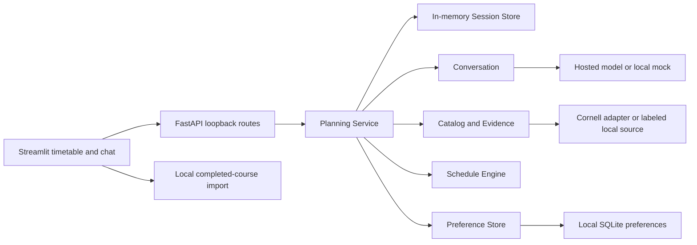
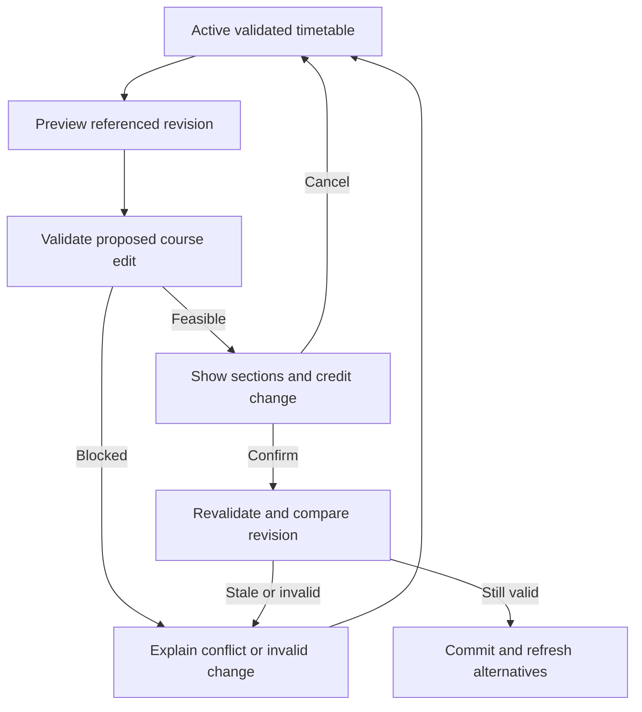

# CourseCompass Component Dependencies

[Design overview](application-design.md) · [Components](components.md) · [Method contracts](component-methods.md) · [Services](services.md)

## Dependency matrix

An arrow in the matrix or diagrams denotes a caller's dependency on a callee. A returned value travels back through the same contract.

| Caller | Callee | Contract and boundary |
| --- | --- | --- |
| Timetable UI | Local API | Local JSON requests and typed replies. Drag and click request the same operation. |
| Timetable UI | Completed-course Import | Local transient parsing. Only confirmed identifiers are submitted to Local API. |
| Local API | Planning Service | In-process application command or query with validated session context. |
| Planning Service | Session Store | In-memory, local-session state with revision-checked transitions. |
| Planning Service | Conversation | Validated profile proposals and explanations built from minimized context and grounded data. |
| Planning Service | Catalog and Evidence | Term-scoped snapshots, course details and provenance. |
| Planning Service | Schedule Engine | Pure scheduling inputs and structured validation, ranking, search or edit outcomes. |
| Planning Service | Preference Store | Explicit local save and restore of the current user's soft preferences. |
| Conversation | Model adapter | Configured hosted provider or local mock. Hosted input excludes original transcripts and raw extracted text. |
| Catalog and Evidence | Cornell adapter and local source | Bounded Cornell retrieval or a labeled snapshot, fixture or permitted evidence file. Approved catalog cache remains local. |
| Preference Store | Local SQLite | Stored soft preferences separated from the local catalog cache's records. |

## Data flow for recommendation and editing

The UI sends a draft or confirmed request to the API, which calls Planning Service. It reads the session and the term snapshot, passes validated input to the engine and requests a grounded explanation. The result returns through the API with the current revision and provenance. The same path previews and confirms edits. PDF parsing runs on the UI side. Model and roster inputs cross separate provider adapters.

## State flow for an individual course edit

A preview reads the active plan without changing it. A blocked edit or a canceled preview leaves the plan intact. Confirming rechecks the exact server-side proposal and matching revision. A successful commit atomically replaces the active plan and refreshes cards. The UI can request a new preview when a stale response includes a newer view.

## Coupling constraints

- Schedule Engine uses domain types and depends on neither UI state nor hosted inference. A pure validator checks every proposed timetable independently of optimizer selection.
- Provider and persistence adapters are behind internal interfaces so test fixtures and stubs exercise the same application paths. Published external content is treated as data.
- Planning Service coordinates tool access through validated, limited operations. Conversation does not call Session Store mutation methods. No confirmed state is changed by a generated tool response.
- Local API returns structured outcomes for empty data, pending clarification, blocked edits, and stale changes. The UI uses these outcomes for messaging and keeps display decisions out of scheduling rules.
