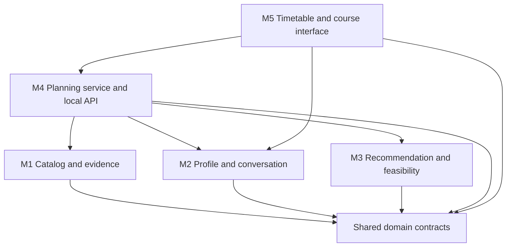

# CourseCompass Unit of Work Dependencies

[Unit and modules](unit-of-work.md) · [Story coverage](unit-of-work-story-map.md) · [Component dependencies](component-dependency.md)

## Deployment boundary

| Unit | Internal deployment prerequisite | Provider and local resources | Required for offline demonstration |
| --- | --- | --- | --- |
| U01 Local CourseCompass application | None. The Streamlit UI and FastAPI service run together as one local release. | Cornell roster adapter, configured model adapter, and local SQLite. | Selected-term synthetic or permitted fixture, mock inference, local process startup, and scripted scenario. Live provider failure is surfaced or handled by the labeled fallback. |

## Internal dependency matrix

Each row names direct dependencies. Shared domain types are agreed first and used by all modules.

| Module | Depends on | Contract and validation checkpoint |
| --- | --- | --- |
| M1 Course catalog and evidence | Shared domain | An immutable term snapshot, stable course and package IDs, and labeled provenance. Verify term isolation and incomplete required section associations. |
| M2 Student profile and conversation | Shared domain | Drafts and explicit confirmations, local course-ID extraction, user-approved saved preferences and validated explanations. Verify the typed output with mock inference and synthetic PDF input. |
| M3 Recommendation and feasibility | Shared domain | Consumes a term snapshot and a confirmed profile as inputs. Returns bounded search outcomes, independently validated schedules, alternative cards and edit previews. Test without live provider calls. |
| M4 Planning service and local API | M1, M2, M3 | Compose catalog, intent and planning ports. Own the profile/timetable revision, guarded commit, and structured result and provenance. Use contract tests for stale or consumed previews and in-progress revisions. |
| M5 Timetable and course interface | M4, M2 | Render local API views and route gestures through the same preview. M2 supplies local PDF-to-ID extraction without sending the file to the API or model. Use versioned mock API responses during UI development. |

### Dependency diagram

The arrows point from a module to its dependency. M1, M2, and M3 use shared types and can be built against fixtures independently. The API in M4 assembles them and publishes the revisioned contract consumed by M5. M5 calls the local M2 import helper and sends only confirmed course identifiers. M3 does not call M1 or M2 at runtime. It receives their normalized data through M4.

## Build order and integration checkpoints

1. Agree on domain contracts for the confirmed profile, stable identifiers, section packages, source provenance, schedule and preview outcomes. Seed shared fixtures for valid, incomplete and conflicting cases.
2. Develop M1, M2 and M3 against those contracts. In parallel, stub the M4 response in M5 and validate both timetable gestures in the planned local UI stack.
3. Integrate the M4 recommendation, preview and commit handlers with the three modules. Verify that a required course, stale preview, or canceled operation leaves the active timetable unchanged.
4. Connect M5 to the real local API. Verify that the timeline uses official section meetings and that missing evidence or offline mode is visible. Run the fixture-backed release acceptance path through the two local processes.
