# CourseCompass Execution Plan

**Status:** Proposed for team review.

**Baseline:** [Approved requirements](../requirements/requirements.md), [requirements decisions](../requirements/requirement-verification-questions.md), [approved stories](../user-stories/stories.md), [approved personas](../user-stories/personas.md), and the [technical environment](../../../docs/technical-environment.md).

**Milestone boundary:** Finish and approve Units Generation for the November 24 midterm. Construction is reserved for the final project, due December 16.

## Detailed analysis

CourseCompass is a greenfield local application for Cornell students across majors. The initial release turns a conversational request into a confirmed planning profile, finds up to three distinct feasible timetables for one selected term, explains the trade-offs, and preserves hard constraints when the student revises a preference. The baseline covers F1–F8 and US-01–US-13. No application package or deployment needs migration.

| Impact area | Expected effect |
| --- | --- |
| User experience | Conversation and profile confirmation feed an interactive weekly timetable, comparison view, course detail panel, and recovery messages for conflicts or missing information. |
| Application structure | Define responsibilities and interfaces for the UI, local application service, LLM interaction, course and evidence adapters, profile handling, and deterministic ranking, solving, and validation. Agree on the boundaries in Application Design. |
| Data model | Represent term-specific offerings, compatible section packages, meeting times and credits, confirmed constraints and preferences, and provenance. The local PDF path returns course identifiers for user review. |
| APIs and integrations | Describe validated local request and response contracts, permitted model tool calls, Cornell Roster access, and labeled fixtures or model mocks. |
| Quality and infrastructure | Run on team laptops with loopback UI and API. Plan for independently validated schedules, bounded retrieval and solving, source attribution, private local transcript handling, and repeatable tests. |
| Operations | Include local diagnostic feedback and safe handling of configuration and credentials in Construction. The course scope requires no hosted deployment or Operations phase. |

### Risk assessment

Overall delivery risk is **medium** for a local MVP, with **complex testing** around course data and schedule validity. Documentation changes are reversible through Git. Construction risk is concentrated at contract boundaries and in external data quality.

| Risk | Mitigation and verification target |
| --- | --- |
| Missing or incompatible lecture, discussion, and lab data can make an invalid timetable look feasible. | Define how section packages enter the solver. Use a separate feasibility check and fixtures for missing associations, overlaps, back-to-back meetings, credit bounds, and required courses. |
| LLM interpretation can lose confirmed constraints or misstate the source of a fact. | Use validated request updates, require confirmation for hard-constraint changes, and ground explanations in validated results and attributed evidence. Exercise an ambiguous constraint update and a preference-only revision. |
| Optional reviews and workload evidence vary by course. | Keep official facts available independently, label missing evidence, document how ranking uses available evidence, and preserve provenance in the UI. |
| An unclear prerequisite, unavailable pinned course, or exhausted search has a different resolution. | Carry these outcomes through the service contract and UI. Use fixtures to distinguish unresolved eligibility, proven infeasibility, missing data, and a bounded search that did not find a candidate. |
| A real transcript or provider failure can disrupt a local demo. | Use synthetic transcript examples, keep original PDFs and raw text local and transient, and use visibly labeled local fixtures or model mocks when the live path is unavailable. |

## Workflow visualization

```mermaid
flowchart TD
    Start(["CourseCompass request"])
    subgraph INCEPTION["INCEPTION"]
        WD["Workspace Detection - complete"]
        RE["Reverse Engineering - skipped"]
        RA["Requirements Analysis - approved"]
        US["User Stories - approved"]
        WP["Workflow Planning - review pending"]
        AD["Application Design - execute"]
        UG["Units Generation - execute"]
    end
    Midterm(["Midterm stop after Units approval"])
    subgraph CONSTRUCTION["CONSTRUCTION - later final project"]
        FD["Functional Design - per unit"]
        NR["NFR Requirements - per unit"]
        ND["NFR Design - per unit"]
        ID["Infrastructure Design - reassess per unit"]
        CG["Code Generation - per unit"]
        BT["Build and Test - after all units"]
    end
    subgraph OPERATIONS["OPERATIONS"]
        OPS["Operations - skipped for the course"]
    end
    Final(["Course project complete"])
    Start --> WD
    WD --> RE
    RE --> RA
    RA --> US
    US --> WP
    WP -->|After approval| AD
    AD -->|After approval| UG
    UG -->|After approval| Midterm
    Midterm -.->|Later authorization| FD
    FD --> NR
    NR --> ND
    ND --> ID
    ID --> CG
    CG -->|Next unit if any| FD
    CG -->|All units complete| BT
    BT --> OPS
    OPS --> Final
    style Start fill:#CE93D8,stroke:#6A1B9A,stroke-width:3px,color:#000
    style Midterm fill:#CE93D8,stroke:#6A1B9A,stroke-width:3px,color:#000
    style Final fill:#CE93D8,stroke:#6A1B9A,stroke-width:3px,color:#000
    style INCEPTION fill:#BBDEFB,stroke:#1565C0,color:#000
    style CONSTRUCTION fill:#C8E6C9,stroke:#1B5E20,color:#000
    style OPERATIONS fill:#FFF59D,stroke:#F9A825,color:#000
    style WD fill:#4CAF50,stroke:#1B5E20,stroke-width:3px,color:#fff
    style RE fill:#BDBDBD,stroke:#424242,stroke-width:2px,stroke-dasharray:5 5,color:#000
    style RA fill:#4CAF50,stroke:#1B5E20,stroke-width:3px,color:#fff
    style US fill:#4CAF50,stroke:#1B5E20,stroke-width:3px,color:#fff
    style WP fill:#4CAF50,stroke:#1B5E20,stroke-width:3px,color:#fff
    style AD fill:#FFA726,stroke:#E65100,stroke-width:3px,stroke-dasharray:5 5,color:#000
    style UG fill:#FFA726,stroke:#E65100,stroke-width:3px,stroke-dasharray:5 5,color:#000
    style FD fill:#FFA726,stroke:#E65100,stroke-width:3px,stroke-dasharray:5 5,color:#000
    style NR fill:#FFA726,stroke:#E65100,stroke-width:3px,stroke-dasharray:5 5,color:#000
    style ND fill:#FFA726,stroke:#E65100,stroke-width:3px,stroke-dasharray:5 5,color:#000
    style ID fill:#BDBDBD,stroke:#424242,stroke-width:2px,stroke-dasharray:5 5,color:#000
    style CG fill:#4CAF50,stroke:#1B5E20,stroke-width:3px,color:#fff
    style BT fill:#4CAF50,stroke:#1B5E20,stroke-width:3px,color:#fff
    style OPS fill:#BDBDBD,stroke:#424242,stroke-width:2px,stroke-dasharray:5 5,color:#000
    linkStyle default stroke:#333,stroke-width:2px
```

**Text alternative.** Workspace Detection is complete and Reverse Engineering was skipped. Requirements Analysis and User Stories are approved. Next, review Workflow Planning, then execute and review Application Design, then plan, generate and approve the units of work. Stop at the midterm boundary. In a later session authorized for the final project, assess the applicable Construction design stages per unit, generate each unit, then build and test the integrated MVP. Operations is skipped.

## Stage decisions and depth

### Inception

| Status | Stage | Depth and rationale |
| --- | --- | --- |
| Complete | Workspace Detection | Established the greenfield baseline and loaded the project workflow. |
| Skip | Reverse Engineering | There is no existing application to reverse-engineer. |
| Approved | Requirements Analysis | Comprehensive due to cross-major scope, section compatibility, data quality, and privacy. |
| Approved | User Stories | Thirteen stories and four personas cover the student journey and distinct recovery outcomes. |
| Proposed | Workflow Planning | This document records the scope, sequence, risks, and milestone gates. |
| Execute | Application Design | Detailed because the local app needs new component and service contracts. Produce components.md, component-methods.md, services.md, and component-dependency.md. Use representative initial, revision, and failure paths to check that the contracts carry enough information. |
| Execute | Units Generation | Detailed because UI, data access, model orchestration, and deterministic scheduling must integrate. Produce unit-of-work.md, unit-of-work-dependency.md, and unit-of-work-story-map.md. Define testable boundaries, dependencies, and integration checkpoints with coverage of every approved story. |

### Construction and Operations

Construction awaits later authorization. These are planning recommendations to reassess against the approved units.

| Stage | Recommendation for the final project |
| --- | --- |
| Functional Design | Execute for units with new domain models, feasibility logic, scoring, or state transitions. Keep simpler units concise. |
| NFR Requirements and NFR Design | Execute where correctness validation, privacy, provider limits, provenance, or demo reproducibility affect the unit. Plan end-to-end checks across unit boundaries. |
| Infrastructure Design | Expect to skip a separate infrastructure design for loopback-only hosting with local storage. Reassess if an approved unit needs an infrastructure mapping. |
| Code Generation | Execute for each approved unit, with tests alongside the implementation. |
| Build and Test | Execute after all units. Exercise the initial recommendation, preference-only revision, unavailable required course, infeasible search, and labeled demo fallback. |
| Operations | Skip for this course. |

### Extensions

Security Baseline and Resiliency Baseline are disabled by the recorded requirements decisions. NFR-02 and NFR-04 still apply. Property-Based Testing remains in Partial mode. PBT-02, PBT-03, PBT-07, PBT-08, and PBT-09 are each **N/A to Workflow Planning**. Carry Hypothesis and pytest into Construction planning for deterministic properties such as profile round-trips, validator invariants, domain-specific generators, shrinking and reproducibility.

## Estimated timeline and success criteria

Two Inception stages follow review of this plan. As a planning estimate, reserve one shared review block for Application Design and one for Units Generation before November 24, with time to resolve questions and check repository access before submitting. The team will confirm meeting times and the Canvas submitter. Final-project construction and the integrated demo are due December 16.

- **Workflow Planning gate.** Confirm that the sequence, required artifacts, and stop point match the course scope. The team may request modifications or propose adding a skipped stage where justified.
- **Application Design gate.** Confirm that the defined component and service interfaces support the approved feature set and exception paths. Verify consistency with source provenance, local data handling, and deterministic feasibility requirements.
- **Units Generation gate.** Confirm that the units have clear deliverables and dependencies and that all 13 approved stories map to a unit or explicitly shared integration check. Record team approval, then stop before Construction.
- **Midterm release.** Confirm the two inputs, all five required Inception outputs, audit and state are on GitHub. Verify that the repository opens without sign-in. The designated team member submits the repository URL on Canvas.
